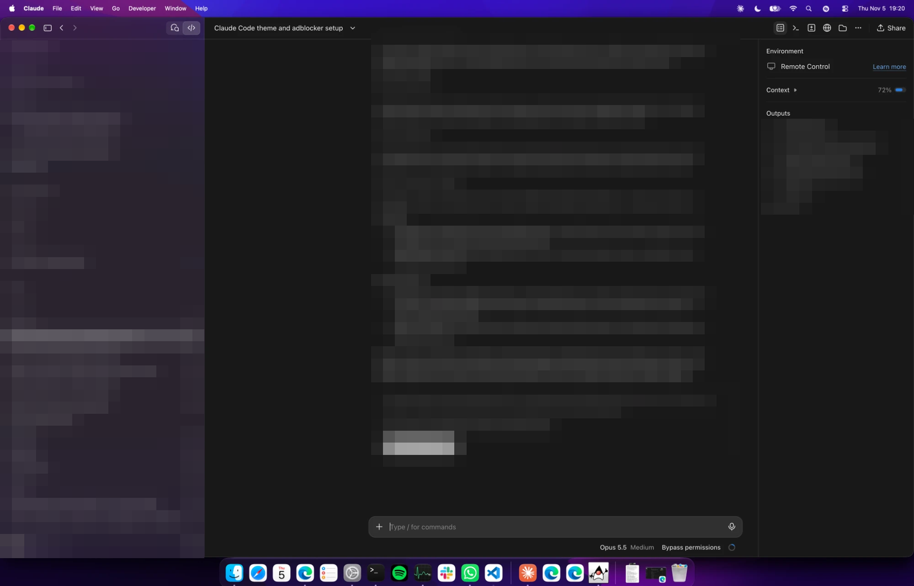
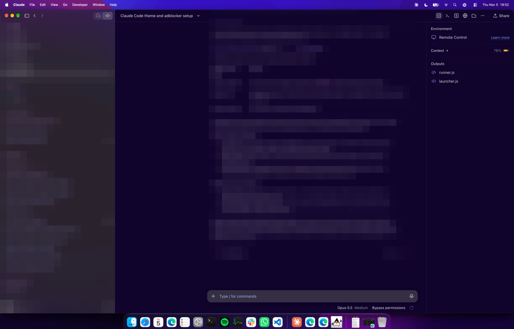

# Claude Purple 💜

A purple reskin for the **Claude desktop app** (Windows and macOS) and **Claude Code**, using the palette of the VS Code theme [Modern Purple Theme Dark](https://github.com/nataliefruitema/modern-purple-theme). It also includes **browser-ad-remover**, a Claude Code plugin that strips ads from pages in Claude's built-in browser.

| Before | After |
|---|---|
|  |  |

<sub>Session names and conversation text are blurred in both screenshots.</sub>

> **Unofficial.** Not made by, endorsed by, or affiliated with Anthropic. It changes colours only, so the app works exactly as before. It relies on Developer Mode and on the app's internal colour names, so an app update can partly undo it until the theme file is updated.

## Quick start: let Claude set it up
Clone the repo, open Claude Code in it, and ask:

```
git clone https://github.com/happyc0der/claude-purple
cd claude-purple
claude "Set up Claude Purple for me"
```

Claude follows [AGENTS.md](AGENTS.md). It asks before turning on Developer Mode or restarting anything, runs the installer for your OS and checks the logs. On macOS, one step is yours: granting Accessibility to the small helper app.

## What you get

| Part | What it does |
|---|---|
| **Desktop reskin** | Recolours the whole app: sidebar, chat, Changes/Files/Terminal panes, menus, settings, placeholders, and code blocks with the theme's syntax colours. A watcher re-applies it every time Claude starts. |
| **CLI theme** | Claude Code's own custom-theme file for the terminal UI. |
| **browser-ad-remover** | Removes ad markup and empty ad slots before Claude reads or screenshots a page in the built-in browser. `/browser-ads` toggles it. |
| **Windows Terminal scheme** | A matching colour scheme for your terminal. |

## Manual setup

<details>
<summary><b>Claude Code CLI theme</b></summary>

Copy `cli/modern-purple.json` to `~/.claude/themes/`, then pick **Modern Purple** in `/theme`, or set `"theme": "custom:modern-purple"` in `~/.claude/settings.json`.
</details>

<details>
<summary><b>browser-ad-remover plugin</b></summary>

```
/plugin marketplace add happyc0der/claude-purple
/plugin install browser-ad-remover@claude-purple
```
</details>

<details>
<summary><b>Desktop reskin: Windows</b></summary>

```powershell
pwsh -ExecutionPolicy Bypass -File windows\install.ps1
```
1. Fully quit Claude from the tray, then reopen it.
2. Once, run `pwsh -File windows\apply-theme.ps1 -AllowPasting` and don't touch the keyboard or mouse for about 10 seconds.

The colours then come back by themselves on every restart.
</details>

<details>
<summary><b>Desktop reskin: macOS</b></summary>

```bash
bash macos/install.sh
```
1. Open **System Settings > Privacy & Security > Accessibility**, click **+**, and add `~/Applications/ClaudePurple.app`.
2. Quit and reopen Claude.

After a few idle seconds, a DevTools window flashes up and Claude turns purple.
</details>

## How it works
The Claude desktop app has no custom-theme support, its files are signed and integrity-checked, and it blocks remote debugging, so nothing is patched. Instead:

1. **Developer Mode**, the app's own option, enables DevTools.
2. When Claude starts, a small watcher (a per-user logon task on Windows, a LaunchAgent on macOS) waits until you've stopped typing, opens DevTools, and pastes [`theme/modern-purple.js`](theme/modern-purple.js) into the console.
3. That script only sets **colour values**. It finds the app's neutral greys at runtime, including styles that menus load later, and shifts their hue while keeping their brightness. It also maps the app's code theme to the VS Code theme's syntax colours, including inside code blocks.

**Safety:**
- **Window check:** the automation only types after confirming, by window title, that the focused window is Claude's "Developer Tools". Otherwise it stops.
- **Your input comes first:** it waits until the keyboard and mouse have been idle for 4 seconds, and restores your clipboard afterwards.
- **Logged:** every run is recorded.
- **Read the scripts first:** they're short, and Developer Mode gives DevTools access to your signed-in session.

## browser-ad-remover: what it saves
Claude Code's built-in browser has no extension or content-blocking support, so the plugin hooks the browser tools and runs a small sweep just before Claude reads or screenshots a page. Measured on three ad-heavy pages:

| Page | Ad elements removed | Page text | Ad iframes | First screen that was ads |
|---|---|---|---|---|
| AccuWeather | 7 | unchanged | 4 → 4 | ~31% (empty slots) |
| Daily Mail | 37 | −0.3% | 31 → 12 | ~31% |
| Allrecipes | 36 | ~0% | 21 → 14 | high (overlapping slots, overstated) |

**Honest summary:** it barely changes text tokens. The win is screenshots: more real content and less ad space per screenshot, so Claude needs fewer of them. Ads still download, because they're removed from the page rather than blocked.

## Limitations
- **Terminal text:** the terminal pane sets its text colours in code, so only its background is recoloured.
- **Page reloads on macOS:** a reload without an app restart isn't detected yet. Windows notices and re-applies.
- **Pop-out windows:** quick entry and other separate windows aren't recoloured.
- **App updates:** if Anthropic renames its colour values, parts fall back to the default colours until the theme file is updated.

## Uninstall
Run `windows/uninstall.ps1` or `macos/uninstall.sh`, then restart Claude. On macOS, also remove ClaudePurple from the Accessibility list.

## Credits
Colours from **Modern Purple Theme** by [nataliefruitema](https://github.com/nataliefruitema/modern-purple-theme). That theme declares no licence, so no files from it are included here, only its colour values, applied with original code. This repository is MIT-licensed.
